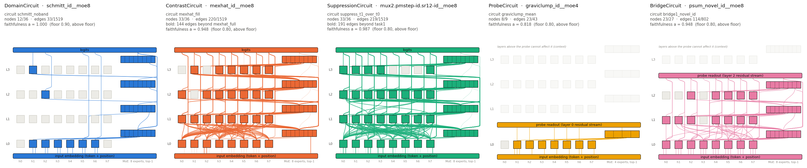

# Key results

Every number on this page is read from a file in the repository that a documented command regenerates:

| section | source file | regenerated by |
|---|---|---|
| [1. Showcase](#1-showcase-one-circuit-per-class) | `results/showcase/*/circuit.json` | `python results/showcase/reproduce.py --verify` (re-evaluates) / `--full` (re-discovers); both need the checkpoints, which are not included ([reproducing.md](reproducing.md)) |
| [2. Zoo](#2-the-zoo) | `results/zoo/stats.md` | `python results/zoo/zoo_stats.py` (from the committed index CSVs) |
| [3. segrev3 case study](#3-the-segrev3-case-study) | `docs/segrev3_case_study.md` and the artifacts it cites | [segrev3_runbook.md](segrev3_runbook.md) |

There is no ground-truth circuit. Each circuit below is the smallest faithful candidate that the
finders produced, and a smaller faithful circuit may exist ([circuits.md §2](circuits.md#2-a-circuit)).

## 1. Showcase: one circuit per class

Each example is a 4-layer × 8-head MoE transformer, scored with the class definitions of
[circuits.md](circuits.md). Candidates come from EAP-IG, and
`evaluate_circuit.py --select` picks the candidate above the floor with the highest selection
score. Cards, figures and exact commands are in [`results/showcase/`](../results/showcase/).

| class | model / circuit | scored by | nodes | edges | *a* = *a*clean × *a*corrupt | held-out *a* (seed 1) | floor | selection score |
|---|---|---|---|---|---|---|---|---|
| DomainCircuit | `schmitt_id__moe8` / `schmitt_noband` | mean ablation | 12 / 36 | 33 / 1519 (2.2%) | 1.000 | 1.000 | 0.90 | 0.652 |
| ContrastCircuit | `mexhat_id__moe8` / `mexhat_fill` | interchange patching | 33 / 36 | 220 / 1519 (14.5%) | 0.948 = 0.983 × 0.964 | 0.960 | 0.80 | 0.071 |
| SuppressionCircuit | `mux2.pmstep-id.sr12-id__moe8` / `suppress_t1_over_t0` | mean ablation | 33 / 36 | 219 / 1519 (14.4%) | 0.987 = 0.989 × 0.998 | 0.986 | 0.80 | 0.071 |
| ProbeCircuit | `graviclump_id__moe4` / `graviclump_mean` | per-position probe at layer 0 | 8 / 9 | 23 / 43 (53.5%) | 0.818 = 0.854 × 0.957 | 0.815 | 0.80 | 0.052 |
| BridgeCircuit | `psum_novel_id__moe8` / `bridge1_novel_id` | per-position probe at layer 2 | 23 / 27 | 114 / 802 (14.2%) | 0.948 = 0.967 × 0.981 | 0.951 | 0.80 | 0.127 |

All five clear their floors. `--select` picks the winner on the same rows it reports, so each
shipped circuit is also re-evaluated with `--seed 1`, which draws fresh evaluation rows and fresh
mean-reference rows (`heldout_seed1.json` in each example directory). All five also clear their
floors on those held-out rows.

For the contrast and suppression examples the reported circuit is the whole selected candidate.
The fringe beyond the base DomainCircuit is listed alongside as the class-specific part.

Notes on each example:

- **Domain.** On inputs without 4s and 5s the Schmitt trigger's memory is never used. A 12-node,
  33-edge circuit (2.2% of the edges) reproduces every output sequence; the empty circuit scores
  0.001.
- **Contrast.** Interchange patching keeps the 1,964 of 5,000 pairs whose edit changes some output
  other than the edited digit's own slot: 3,032 were pure pass-throughs and 4 left the outputs
  unchanged. The circuit keeps 33 of 36 nodes but only 14.5% of the edges. Its fringe beyond the
  `mexhat_full` DomainCircuit is 33 nodes and 144 edges. Under mean ablation the same circuit
  scores 0.919, a number that is not comparable with the patched one.
- **Suppression.** Each row is scored against its own task's output, so the circuit has to run
  both the latch and the parity step and route on the cue. The empty circuit scores 0.344 on the
  latch-cued rows and 0 on the parity-cued rows. The fringe beyond the latch's own DomainCircuit
  (`task1`) is 33 nodes and 191 edges.
- **Probe.** The probe sits at layer 0, where only 43 edges can reach it. On those rows the full
  model's probe decodes the input's rounded mean with accuracy 0.947, against 0.397 for the
  majority class. A 23-edge circuit scores *a* = 0.818. On held-out rows it scores 0.815, just
  above the floor. The canonical four-rung ladder tops out at 17 edges (best *a* = 0.668), so
  explicit rungs up to 43 were added. Both pair pools were swept and all candidates entered one
  selection. Discovery and evaluation read the per-position probe, which for this single-position
  variable is identical to the pooled one.
- **Bridge.** The novelty flag "is this digit new?" is decodable inside `psum∘novel` at layer 2:
  the full model's per-position probes score 0.997 on the probed positions, against 0.657 for the
  majority class. Discovery and evaluation both read these probes. 114 of the 802 reachable edges
  (23 of 27 nodes) carry the flag with *a* = 0.948, and 0.951 on held-out rows. The winning
  candidate comes from the `psum_novel_fresh` pairs, in which a repeated digit is replaced by an
  unseen one.

The two paired circuits that read the logits (contrast and suppression) are sparse in edges but
not in nodes. The selection score multiplies the node and edge complements, so it ranks them low
(0.071) even though they keep only about 14% of the edges.

## 2. The zoo

The zoo contains 1,276 checkpoints of 216 base algorithms over the eight architectures
([models.md](models.md)), with 4,061 circuit records and 571 probed variables. The statistics are
regenerated from a compact index of the discovery runs ([`results/zoo/`](../results/zoo/)). The
runs themselves are documented in [reproducing.md](reproducing.md) but are not re-run here.

**The zoo uses a different selection rule from the showcase.** The zoo runs selected circuits with
the pipeline's selection stage ([circuits.md §6.2](circuits.md#62-smallest_faithful_circuitpy--the-zoo-wide-runs)):

- DomainCircuits: mean-ablation accuracy at floor 0.85 (0.90 in an earlier run);
- ContrastCircuits: fringes, with candidate ∪ base at 0.85 (0.90 in the earlier run);
- SuppressionCircuits: fringes, kept if severing them *releases* the other task (release ≥ 0.5).

These rules are not the per-class definitions of [circuits.md §4](circuits.md#4-faithfulness-a-by-circuit-class),
so zoo numbers and showcase numbers are not comparable.

### Faithful circuits are found for most domain and contrast declarations

| class | faithful / evaluated | rate |
|---|---|---|
| DomainCircuit | 1,942 / 2,157 | 90.0% |
| ContrastCircuit | 1,274 / 1,481 | 86.0% |
| SuppressionCircuit | 125 / 400 | 31.2% |

Faithful SuppressionCircuits appear only in the large, mlp, moe4 and moe8 models. The small, wide,
deep and xl architectures have 2, 2, 1 and 2 multiplexed checkpoints, and none of their 84
suppression rows is faithful. All 125 faithful suppression fringes pass only under the wrong-cue
("tonic") sever reference, which severs the fringe to its mean over rows cued for the *other* task.
A suppressor that is active whatever the cue equals its own mean over the cued rows, so severing
it to that mean removes nothing. Only the wrong-cue mean reveals it
([circuits.md §6.2](circuits.md#62-smallest_faithful_circuitpy--the-zoo-wide-runs)).

### Circuits keep a large share of the heads but a small share of the edges

Pooled over architectures, faithful DomainCircuits keep on average 64.9% of the heads but only
22.0% of the edges; ContrastCircuit fringes keep 39.8% of the heads and 7.0% of the edges. The edge
fraction is below the head fraction in 99.1% of DomainCircuits, 99.6% of ContrastCircuits and all
SuppressionCircuits. Head-level circuit diagrams therefore overstate how much of the model a
circuit uses.

### Domain-circuit sparsity by architecture

| architecture | live edges | median edge fraction (DomainCircuit) | all heads kept | ≥ 1 MLP/MoE node |
|---|---|---|---|---|
| small (2L × 4H, attention-only) | 81 | 53.1% | 65.1% | – |
| large (4L × 8H, attention-only) | 1,281 | 24.7% | 47.2% | – |
| wide (4L × 16H, attention-only) | 4,865 | 9.8% | 28.1% | – |
| deep (8L × 8H, attention-only) | 5,633 | 20.1% | 46.3% | – |
| xl (8L × 16H, attention-only) | 22,017 | 4.4% | 22.7% | – |
| mlp (4L × 8H + MLP) | 1,519 | 6.6% | 27.1% | 98.8% |
| moe4 (4L × 8H + 4 experts) | 1,519 | 3.9% | 21.7% | 99.6% |
| moe8 (4L × 8H + 8 experts) | 1,519 | 3.9% | 22.3% | 100.0% |

Among the attention-only models, the median edge fraction falls as the graph grows, from 53.1% at
small to 4.4% at xl. Deep is the exception: its graph is larger than wide's, but its fraction is
twice as high. At a similar graph size, the MLP and MoE models keep far smaller edge fractions than
large (3.9–6.6% vs. 24.7%). Live edges are the full-graph budgets of
[circuits.md §1](circuits.md#1-the-computational-graph).

**Caveat: architecture and training recipe are confounded.** The MLP/MoE checkpoints were trained
with a different recipe from most of the attention-only ones (675 of 725; [models.md](models.md#known-limitations)).
The difference cannot be attributed to the feed-forward blocks alone.

Nearly every MLP/MoE domain circuit routes through at least one MLP/MoE block. When a block is
dropped it is usually one of the last layers: in the mlp models the dropped set is the last *k*
layers in 95.9% of the 49 circuits that drop a block.

### Most contrast fringes add little beyond the domain circuit

For each faithful ContrastCircuit, `d_affected` is the accuracy drop on the edit-affected outputs
when only the fringe is severed. It is below 0.02 for 77.0–91.5% of fringes, depending on the
architecture. In most models the base DomainCircuit already carries the predicate, so a score
computed on the fringe says little about where the predicate is computed. The showcase instead
scores the whole candidate by interchange patching
([circuits.md §4.1](circuits.md#41-interchange-patching-for-contrastcircuits)).

### Internal variables are decodable early and rarely causal along the probe direction

- 56.0% of the 571 probed variables are `decodable`, 6.5% are `trivial_from_input` (the embedding
  alone decodes them) and 37.5% are `absent`.
- In 91.2% of the decodable variables the first decodable layer is layer 0, the residual stream
  after the first block. That is 51.1% of all probed variables.
- The causal gate patches activations along the probe direction (`validate_probe.py`). It was
  measured on 145 variables; the rest define no counterfactual output or have no steerable rows.
  Only 2 of the 145 pass the output gate (flip rate ≥ 0.80, collateral ≤ 0.05).

A linear probe that decodes a variable does not show that the model uses that direction.

### Training coverage

Not every model in the run list has a checkpoint in this snapshot. `pipeline/models/models.txt`
lists 1,978 models over 262 base algorithms, and 1,276 of them (64.5%) have a checkpoint.

- Coverage is lowest at xl (95 of 242, 39.3%) and highest at moe8 (184 of 242, 76.0%).
- Multiplexed models are the sparsest: 2 of 19 at small, wide and xl, 1 of 19 at deep, 13 of 19 at
  large, and 12 of 19 at each MLP/MoE architecture. So the suppression rows at small, wide, deep
  and xl each come from only one or two models.
- An entry without a checkpoint only means that no checkpoint is in this snapshot. The index does
  not record why.

98.4–100% of each architecture's checkpoints clear the 0.95 evaluation sequence-accuracy gate.
The 8 checkpoints below it, most of them far below, predate the gate: `promote.py` records that
earlier versions of the training scripts wrote checkpoints without it. The current gate would reject them, but they and
their rows are still included in every table. All of these figures are in `results/zoo/stats.md` §1.

## 3. The segrev3 case study

A 4-layer × 8-head attention-only model of `segrev3` reverses each run of non-3 digits and leaves
the 3s in place as boundaries. Manual analysis, ACDC and EAP-IG were compared on it, and all three
point at the same three-stage mechanism:

1. layer-0 detectors find the 3 boundaries and the reflected source position;
2. L1/L2 relay heads carry that information forward;
3. L2/L3 mover heads write the reflected digit.

Full write-up: [segrev3_case_study.md](segrev3_case_study.md).

| result | value | source |
|---|---|---|
| heads needed, by whole-head knockout order (recovered token accuracy) | 16 → 0.84, 18 → 0.91, 24 → 0.98, 30 → 1.00 | `validation/figs_data/data/manual/faithfulness_curve.json` |
| smallest ACDC / EAP-IG circuit with recovered accuracy ≥ 0.80 | EAP-IG top-87: 21 heads, 73 edges, 0.839 | `visualizations/min_faithful_circuit_search.json` |
| solo ablation of a layer-0 detector vs. any later head | 2.0–3.8 vs. ≤ 0.32 logits of margin | `validation/figs_data/data/manual/rough_validation.json` |

The mechanism is **role-sparse but head-dense**: a few named heads per stage carry the story, but
the movers are interchangeable backups, so every faithful subgraph keeps many heads. The
checkpoint must be loaded with parameter-free pre-LayerNorm (`normalization_type="LNPre"`). Loaded
without it, the model scores near chance and raises no error.

## 4. Limitations

- **No ground truth.** The models are trained, not compiled. A reported circuit is the sparsest
  candidate the finders produced above a floor. It is not "the" circuit and is not minimal.
- **The candidate set limits selection.** Selection chooses among EAP-IG's top-*n* rungs plus the
  candidates that the smallest-circuit stage adds (its search, and one round of midpoint
  refinement). The zoo's early run also included ACDC and Edge
  Pruning candidates, which won 12 faithful DomainCircuits (`results/zoo/stats.md` §3). A coarse ladder can miss a smaller faithful circuit
  between rungs, or miss the floor entirely.
- **Definitions matter.** Mean-ablation, interchange-patching and probe-based faithfulness measure
  different things and are not comparable across classes.
- **The zoo is indexed, not re-run.** Its statistics regenerate exactly from the committed index,
  but the hundreds of training and discovery runs behind the index were GPU runs made over several
  versions of the pipeline, and are not reproduced bit-for-bit. Each record states the selection
  regime it was made under.
- **The showcase checkpoints are not included.** The showcase numbers were computed on checkpoints
  identified by the sha256 in each `circuit.json`. Retraining draws a different training pool
  (unseeded), so rerunning the showcase on retrained models reproduces the method, not these exact
  circuits and numbers.
- **Floating point.** CPU results depend on the thread count. The showcase evaluator fixes
  `--threads 4` and reproduces its stored numbers exactly at that setting. Other settings can move
  the last digits.
