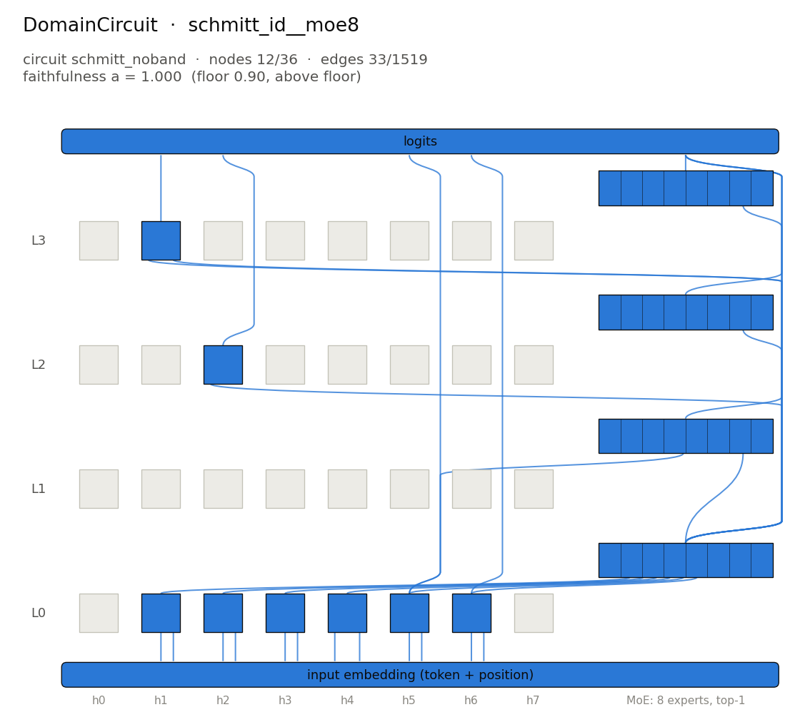

# DomainCircuit: `schmitt_id__moe8` / `schmitt_noband`



## The algorithm

A Schmitt trigger: a switch with a high and a low threshold plus memory. The model reads the digits left to right and keeps a state that starts high (9). A digit of 3 or less switches the state low (0), a digit of 6 or more switches it high (9), and the digits 4 and 5 leave it unchanged. Each output digit is the current state.

The circuit is conditioned on inputs that contain no 4 or 5 (`schmitt_noband`). On that domain the memory is never consulted: every output digit is a threshold test of the input digit at the same position. The DomainCircuit is that memoryless threshold detector.

Reference expression: `Schmitt(Id(10))`.

## The model

Checkpoint: `pipeline/models/trained_models_pt/schmitt_id__moe8.pt` (not included in the repository; sha256 `ac62dd0260ccb6cf…`).

| | |
|---|---|
| layers | 4 |
| attention heads per layer | 8 |
| hidden size | 128 |
| head size | 32 |
| feed-forward | mixture of experts: 8 experts of width 128, top-1 routing, gelu |
| vocabulary | 10 tokens |
| context | 20 positions |

## Inputs and outputs

Inputs drawn from the circuit's domain (`schmitt_noband.sample(4, seed=0)`), the reference output and the model's greedy output:

| input (domain) | algorithm output | model output | match |
|---|---|---|---|
| `9 3 7 6 1 7 3 2 9 8` | `9 0 9 9 0 9 0 0 9 9` | `9 0 9 9 0 9 0 0 9 9` | yes |
| `0 2 3 8 2 8 7 2 1 1` | `0 0 0 9 0 9 9 0 0 0` | `0 0 0 9 0 9 9 0 0 0` | yes |
| `1 3 7 3 1 2 7 9 9 9` | `0 0 9 0 0 0 9 9 9 9` | `0 0 9 0 0 0 9 9 9 9` | yes |
| `6 6 7 2 1 1 9 0 7 0` | `9 9 9 0 0 0 9 0 9 0` | `9 9 9 0 0 0 9 0 9 0` | yes |

## The circuit

Faithfulness `a` is the circuit's whole-sequence accuracy on inputs drawn from the conditioned domain, under edge-level mean ablation: every reader (each head's Q, K and V input, each MLP input, the logits) receives the full model's per-position mean residual plus the live contribution of exactly the circuit's senders, and circuit nodes are recomputed from their declared input edges.

| | |
|---|---|
| nodes | 12 of 36 (8 heads, 4 MLP/MoE blocks) |
| edges | 33 of 1519 |
| faithfulness `a` | 1.0000 |
| floor | 0.90 (above the floor) |
| held-out `a` (seed 1: fresh rows) | 1.0000 (above the floor; see [heldout_seed1.json](heldout_seed1.json)) |
| selection score (1 − nodes/full)·(1 − edges/full) | 0.6522 |
| selected candidate | `pipeline/circuits_data/schmitt_id__moe8/schmitt_noband/circuits/eap_top48` (generated by `reproduce.py --full`, gitignored) |
| candidates evaluated | 6 (selection modes: `candidate`; see [candidates.json](candidates.json), whose candidate paths are generated by `reproduce.py --full`, gitignored) |
| reference: unablated model / empty circuit | `a` = 1.0000 / 0.0010 |
| ablation | mean |

### Components

Nodes: `a0.h1`, `a0.h2`, `a0.h3`, `a0.h4`, `a0.h5`, `a0.h6`, `m0`, `m1`, `a2.h2`, `m2`, `a3.h1`, `m3`.

<details><summary>All edges (writer → reader, with the head input they enter)</summary>

- `input → a0.h1 (K)`
- `input → a0.h1 (V)`
- `input → a0.h2 (K)`
- `input → a0.h2 (V)`
- `input → a0.h3 (K)`
- `input → a0.h3 (V)`
- `input → a0.h4 (Q)`
- `input → a0.h4 (V)`
- `input → a0.h5 (K)`
- `input → a0.h5 (V)`
- `input → a0.h6 (K)`
- `input → a0.h6 (V)`
- `a0.h1 → m0`
- `a0.h2 → m0`
- `a0.h3 → m0`
- `a0.h4 → m0`
- `a0.h5 → m0`
- `a0.h6 → m0`
- `a0.h5 → m1`
- `m0 → m1`
- `m0 → a2.h2 (Q)`
- `m0 → m2`
- `m0 → a3.h1 (Q)`
- `m0 → a3.h1 (V)`
- `m0 → m3`
- `a0.h5 → logits`
- `a0.h6 → logits`
- `m0 → logits`
- `m1 → logits`
- `a2.h2 → logits`
- `m2 → logits`
- `a3.h1 → logits`
- `m3 → logits`

</details>

## Regenerate

Re-evaluate the stored circuit (CPU, seconds to minutes):

```bash
python pipeline/find_circuits/evaluate_circuit.py --model schmitt_id__moe8 --circuit schmitt_noband --candidate results/showcase/01_domain_schmitt_id__moe8/circuit.json --device cpu --seed 0 --threads 4 --out <out.json>
```

Held-out re-evaluation (seed 1):

```bash
python pipeline/find_circuits/evaluate_circuit.py --model schmitt_id__moe8 --circuit schmitt_noband --candidate results/showcase/01_domain_schmitt_id__moe8/circuit.json --device cpu --seed 1 --threads 4 --out <out.json>
```

Re-run discovery and selection from the checkpoint: see [`../COMMANDS.md`](../COMMANDS.md) or `python results/showcase/reproduce.py --full`.
