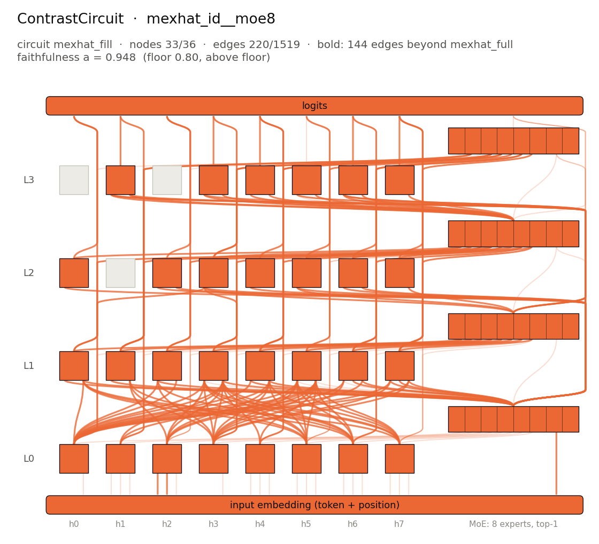

# ContrastCircuit: `mexhat_id__moe8` / `mexhat_fill`



## The algorithm

A dip detector (a "Mexican hat" veto). Every interior digit is compared with its two neighbours: if the neighbours' sum exceeds twice the digit by 4 or more (a sharp local dip), the output at that position is 0; otherwise the digit is copied. The first and last digits are always copied.

`mexhat_fill` pairs a random input with a one-digit edit of it that changes the output. The reported ContrastCircuit is the selected candidate under interchange patching: the part of the model that carries the effect of that edit to the output positions where the two outputs disagree. Its fringe beyond the domain circuit `mexhat_full` is listed alongside.

Reference expression: `MexicanHatVeto(Id(10))`.

## The model

Checkpoint: `pipeline/models/trained_models_pt/mexhat_id__moe8.pt` (not included in the repository; sha256 `f40268b41132cbc0…`).

| | |
|---|---|
| layers | 4 |
| attention heads per layer | 8 |
| hidden size | 128 |
| head size | 32 |
| feed-forward | mixture of experts: 8 experts of width 128, top-1 routing, gelu |
| vocabulary | 10 tokens |
| context | 20 positions |

## Inputs and outputs

Clean/corrupt pairs from `mexhat_fill.sample_pairs(4, seed=0)`; each corrupt input is the clean one with a single digit changed (position given, counting from 0):

| pair | member | input | algorithm output | model output |
|---|---|---|---|---|
| 0 (edit at 3) | clean | `3 8 2 1 4 0 3 2 0 6` | `3 8 0 0 4 0 3 2 0 6` | `3 8 0 0 4 0 3 2 0 6` |
| 0 (edit at 3) | corrupt | `3 8 2 6 4 0 3 2 0 6` | `3 8 0 6 4 0 3 2 0 6` | `3 8 0 6 4 0 3 2 0 6` |
| 1 (edit at 7) | clean | `9 9 8 0 4 0 6 1 3 7` | `9 9 8 0 4 0 6 0 3 7` | `9 9 8 0 4 0 6 0 3 7` |
| 1 (edit at 7) | corrupt | `9 9 8 0 4 0 6 3 3 7` | `9 9 8 0 4 0 6 3 0 7` | `9 9 8 0 4 0 6 3 0 7` |
| 2 (edit at 8) | clean | `2 7 9 5 1 2 5 9 4 6` | `2 7 9 5 0 2 5 9 0 6` | `2 7 9 5 0 2 5 9 0 6` |
| 2 (edit at 8) | corrupt | `2 7 9 5 1 2 5 9 7 6` | `2 7 9 5 0 2 5 9 7 6` | `2 7 9 5 0 2 5 9 7 6` |
| 3 (edit at 1) | clean | `9 6 0 1 0 2 9 3 9 0` | `9 6 0 1 0 0 9 0 9 0` | `9 6 0 1 0 0 9 0 9 0` |
| 3 (edit at 1) | corrupt | `9 2 0 1 0 2 9 3 9 0` | `9 0 0 1 0 0 9 0 9 0` | `9 0 0 1 0 0 9 0 9 0` |

## The circuit

Faithfulness is measured by interchange patching on clean/corrupt pairs that share one teacher-forced prefix (the clean input's true output). Each row's ablation baseline is its partner's unablated activations, and the labels are the full model's own outputs. Forward: start from the corrupt run, patch the clean row in through the circuit's edges, and require the full model's clean output (`a_clean`). Reverse: the mirror image (`a_corrupt`). `a = a_clean × a_corrupt`. Pairs whose outputs do not differ, or differ only by the edited digit copied straight through, are dropped. The empty circuit scores 0 and the full model 1 by construction, so the circuit is the path that carries the edit's effect, and parts of the model the edit never changes drop out without subtracting the domain circuit; the reported circuit is the selected candidate itself, and its fringe beyond the declared domain circuit is listed alongside. Interchange faithfulness is not comparable with mean-ablation faithfulness (the latter is listed as secondary).

| | |
|---|---|
| nodes | 33 of 36 (29 heads, 4 MLP/MoE blocks) |
| edges | 220 of 1519 |
| faithfulness `a` | 0.9477 = 0.9832 (`a_clean`) × 0.9638 (`a_corrupt`) |
| floor | 0.80 (above the floor) |
| held-out `a` (seed 1: fresh rows) | 0.9596 = 0.9850 × 0.9742 (above the floor; see [heldout_seed1.json](heldout_seed1.json)) |
| selection score (1 − nodes/full)·(1 − edges/full) | 0.0713 |
| selected candidate | `pipeline/circuits_data/mexhat_id__moe8/mexhat_fill/circuits/eap_top228` (generated by `reproduce.py --full`, gitignored) |
| candidates evaluated | 5 (selection modes: `candidate`; see [candidates.json](candidates.json), whose candidate paths are generated by `reproduce.py --full`, gitignored) |
| reference: unablated model / empty circuit | `a` = 1.0000 / 0.0000 |
| ablation | interchange |
| mean-ablation `a` (secondary, not comparable) | 0.9185 |
| pairs evaluated | 1964 of 5000 drawn (dropped: duplicate 0, identical labels 4, pass through 3032) |
| fringe beyond `mexhat_full` | 33 nodes, 144 edges (base: [`base_circuit.json`](base_circuit.json)) |

### Components

Nodes: `a0.h0`, `a0.h1`, `a0.h2`, `a0.h3`, `a0.h4`, `a0.h5`, `a0.h6`, `a0.h7`, `m0`, `a1.h0`, `a1.h1`, `a1.h2`, `a1.h3`, `a1.h4`, `a1.h5`, `a1.h6`, `a1.h7`, `m1`, `a2.h0`, `a2.h2`, `a2.h3`, `a2.h4`, `a2.h5`, `a2.h6`, `a2.h7`, `m2`, `a3.h1`, `a3.h3`, `a3.h4`, `a3.h5`, `a3.h6`, `a3.h7`, `m3`.

Fringe edges (not in `mexhat_full`; drawn bold in the figure):

- `input → a0.h2 (K)`
- `input → a0.h2 (Q)`
- `input → m0`
- `m0 → a1.h0 (Q)`
- `a0.h0 → a1.h0 (V)`
- `a0.h5 → a1.h0 (V)`
- `a0.h6 → a1.h0 (V)`
- `a0.h7 → a1.h0 (V)`
- `m0 → a1.h0 (V)`
- `m0 → a1.h1 (Q)`
- `a0.h2 → a1.h1 (V)`
- `a0.h3 → a1.h1 (V)`
- `a0.h5 → a1.h1 (V)`
- `a0.h0 → a1.h2 (Q)`
- `a0.h3 → a1.h2 (Q)`
- `a0.h6 → a1.h2 (Q)`
- `m0 → a1.h2 (Q)`
- `a0.h0 → a1.h2 (V)`
- `a0.h0 → a1.h3 (Q)`
- `a0.h2 → a1.h3 (Q)`
- `a0.h3 → a1.h3 (Q)`
- `a0.h5 → a1.h3 (Q)`
- `a0.h6 → a1.h3 (Q)`
- `a0.h7 → a1.h3 (Q)`
- `a0.h0 → a1.h3 (V)`
- `a0.h1 → a1.h3 (V)`
- `a0.h2 → a1.h3 (V)`
- `a0.h3 → a1.h3 (V)`
- `a0.h4 → a1.h3 (V)`
- `a0.h5 → a1.h3 (V)`
- `a0.h6 → a1.h3 (V)`
- `a0.h7 → a1.h3 (V)`
- `m0 → a1.h3 (V)`
- `a0.h0 → a1.h4 (Q)`
- `m0 → a1.h4 (Q)`
- `a0.h0 → a1.h4 (V)`
- `a0.h2 → a1.h4 (V)`
- `a0.h3 → a1.h4 (V)`
- `a0.h5 → a1.h4 (V)`
- `a0.h7 → a1.h4 (V)`
- `m0 → a1.h4 (V)`
- `a0.h0 → a1.h5 (Q)`
- `a0.h2 → a1.h5 (Q)`
- `a0.h3 → a1.h5 (Q)`
- `a0.h5 → a1.h5 (Q)`
- `a0.h6 → a1.h5 (Q)`
- `a0.h7 → a1.h5 (Q)`
- `a0.h0 → a1.h5 (V)`
- `a0.h1 → a1.h5 (V)`
- `a0.h2 → a1.h5 (V)`
- `a0.h3 → a1.h5 (V)`
- `a0.h4 → a1.h5 (V)`
- `a0.h5 → a1.h5 (V)`
- `a0.h6 → a1.h5 (V)`
- `a0.h7 → a1.h5 (V)`
- `m0 → a1.h6 (K)`
- `a0.h0 → a1.h6 (Q)`
- `a0.h3 → a1.h6 (Q)`
- `a0.h0 → a1.h6 (V)`
- `m0 → a1.h6 (V)`
- `m0 → a1.h7 (K)`
- `a0.h0 → a1.h7 (Q)`
- `a0.h3 → a1.h7 (Q)`
- `m0 → a1.h7 (Q)`
- `a0.h0 → a1.h7 (V)`
- `a0.h3 → a1.h7 (V)`
- `m0 → a1.h7 (V)`
- `a1.h0 → m1`
- `a1.h1 → m1`
- `a1.h2 → m1`
- `a1.h3 → m1`
- `a1.h4 → m1`
- `a1.h5 → m1`
- `a1.h6 → m1`
- `a1.h7 → m1`
- `m0 → a2.h0 (Q)`
- `m0 → a2.h2 (Q)`
- `m0 → a2.h2 (V)`
- `a0.h0 → a2.h3 (Q)`
- `a0.h3 → a2.h3 (Q)`
- `m0 → a2.h3 (Q)`
- `m1 → a2.h3 (Q)`
- `m0 → a2.h4 (Q)`
- `m0 → a2.h5 (Q)`
- `m1 → a2.h5 (Q)`
- `m0 → a2.h6 (Q)`
- `m0 → a2.h6 (V)`
- `m1 → a2.h7 (V)`
- `a1.h0 → m2`
- `a1.h1 → m2`
- `a1.h2 → m2`
- `a1.h3 → m2`
- `a1.h4 → m2`
- `a1.h6 → m2`
- `a1.h7 → m2`
- `a2.h0 → m2`
- `a2.h3 → m2`
- `a2.h5 → m2`
- `a2.h6 → m2`
- `a2.h7 → m2`
- `m0 → a3.h1 (Q)`
- `m1 → a3.h1 (Q)`
- `m2 → a3.h1 (Q)`
- `m0 → a3.h1 (V)`
- `m2 → a3.h1 (V)`
- `m0 → a3.h3 (Q)`
- `m2 → a3.h3 (Q)`
- `m2 → a3.h3 (V)`
- `m2 → a3.h4 (Q)`
- `m2 → a3.h4 (V)`
- `m1 → a3.h5 (Q)`
- `m2 → a3.h5 (V)`
- `m0 → a3.h6 (Q)`
- `m1 → a3.h6 (Q)`
- `m2 → a3.h6 (Q)`
- `m2 → a3.h6 (V)`
- `m2 → a3.h7 (V)`
- `a0.h1 → m3`
- `a0.h4 → m3`
- `a0.h6 → m3`
- `a1.h1 → m3`
- `a1.h3 → m3`
- `a1.h4 → m3`
- `a1.h5 → m3`
- `a1.h6 → m3`
- `a1.h7 → m3`
- `a2.h3 → m3`
- `a1.h0 → logits`
- `a1.h1 → logits`
- `a1.h2 → logits`
- `a1.h4 → logits`
- `a1.h7 → logits`
- `a2.h0 → logits`
- `a2.h2 → logits`
- `a2.h3 → logits`
- `a2.h4 → logits`
- `a2.h5 → logits`
- `a2.h6 → logits`
- `a2.h7 → logits`
- `a3.h1 → logits`
- `a3.h3 → logits`
- `a3.h4 → logits`
- `a3.h6 → logits`
- `a3.h7 → logits`

<details><summary>All edges (writer → reader, with the head input they enter)</summary>

- `input → a0.h0 (V)`
- `input → a0.h1 (K)`
- `input → a0.h1 (Q)`
- `input → a0.h1 (V)`
- `input → a0.h2 (K)`
- `input → a0.h2 (Q)`
- `input → a0.h2 (V)`
- `input → a0.h3 (V)`
- `input → a0.h4 (K)`
- `input → a0.h4 (Q)`
- `input → a0.h4 (V)`
- `input → a0.h5 (K)`
- `input → a0.h5 (Q)`
- `input → a0.h5 (V)`
- `input → a0.h6 (K)`
- `input → a0.h6 (Q)`
- `input → a0.h6 (V)`
- `input → a0.h7 (K)`
- `input → a0.h7 (Q)`
- `input → a0.h7 (V)`
- `input → m0`
- `a0.h0 → m0`
- `a0.h1 → m0`
- `a0.h2 → m0`
- `a0.h3 → m0`
- `a0.h4 → m0`
- `a0.h5 → m0`
- `a0.h6 → m0`
- `a0.h7 → m0`
- `m0 → a1.h0 (Q)`
- `a0.h0 → a1.h0 (V)`
- `a0.h5 → a1.h0 (V)`
- `a0.h6 → a1.h0 (V)`
- `a0.h7 → a1.h0 (V)`
- `m0 → a1.h0 (V)`
- `m0 → a1.h1 (Q)`
- `a0.h2 → a1.h1 (V)`
- `a0.h3 → a1.h1 (V)`
- `a0.h5 → a1.h1 (V)`
- `a0.h0 → a1.h2 (Q)`
- `a0.h3 → a1.h2 (Q)`
- `a0.h6 → a1.h2 (Q)`
- `m0 → a1.h2 (Q)`
- `a0.h0 → a1.h2 (V)`
- `a0.h0 → a1.h3 (Q)`
- `a0.h2 → a1.h3 (Q)`
- `a0.h3 → a1.h3 (Q)`
- `a0.h5 → a1.h3 (Q)`
- `a0.h6 → a1.h3 (Q)`
- `a0.h7 → a1.h3 (Q)`
- `m0 → a1.h3 (Q)`
- `a0.h0 → a1.h3 (V)`
- `a0.h1 → a1.h3 (V)`
- `a0.h2 → a1.h3 (V)`
- `a0.h3 → a1.h3 (V)`
- `a0.h4 → a1.h3 (V)`
- `a0.h5 → a1.h3 (V)`
- `a0.h6 → a1.h3 (V)`
- `a0.h7 → a1.h3 (V)`
- `m0 → a1.h3 (V)`
- `a0.h0 → a1.h4 (Q)`
- `m0 → a1.h4 (Q)`
- `a0.h0 → a1.h4 (V)`
- `a0.h2 → a1.h4 (V)`
- `a0.h3 → a1.h4 (V)`
- `a0.h5 → a1.h4 (V)`
- `a0.h7 → a1.h4 (V)`
- `m0 → a1.h4 (V)`
- `a0.h0 → a1.h5 (Q)`
- `a0.h2 → a1.h5 (Q)`
- `a0.h3 → a1.h5 (Q)`
- `a0.h5 → a1.h5 (Q)`
- `a0.h6 → a1.h5 (Q)`
- `a0.h7 → a1.h5 (Q)`
- `m0 → a1.h5 (Q)`
- `a0.h0 → a1.h5 (V)`
- `a0.h1 → a1.h5 (V)`
- `a0.h2 → a1.h5 (V)`
- `a0.h3 → a1.h5 (V)`
- `a0.h4 → a1.h5 (V)`
- `a0.h5 → a1.h5 (V)`
- `a0.h6 → a1.h5 (V)`
- `a0.h7 → a1.h5 (V)`
- `m0 → a1.h5 (V)`
- `m0 → a1.h6 (K)`
- `a0.h0 → a1.h6 (Q)`
- `a0.h3 → a1.h6 (Q)`
- `m0 → a1.h6 (Q)`
- `a0.h0 → a1.h6 (V)`
- `m0 → a1.h6 (V)`
- `m0 → a1.h7 (K)`
- `a0.h0 → a1.h7 (Q)`
- `a0.h3 → a1.h7 (Q)`
- `m0 → a1.h7 (Q)`
- `a0.h0 → a1.h7 (V)`
- `a0.h3 → a1.h7 (V)`
- `m0 → a1.h7 (V)`
- `a0.h0 → m1`
- `a0.h1 → m1`
- `a0.h2 → m1`
- `a0.h3 → m1`
- `a0.h4 → m1`
- `a0.h5 → m1`
- `a0.h6 → m1`
- `a0.h7 → m1`
- `m0 → m1`
- `a1.h0 → m1`
- `a1.h1 → m1`
- `a1.h2 → m1`
- `a1.h3 → m1`
- `a1.h4 → m1`
- `a1.h5 → m1`
- `a1.h6 → m1`
- `a1.h7 → m1`
- `m0 → a2.h0 (Q)`
- `m0 → a2.h2 (Q)`
- `m0 → a2.h2 (V)`
- `a0.h0 → a2.h3 (Q)`
- `a0.h3 → a2.h3 (Q)`
- `m0 → a2.h3 (Q)`
- `m1 → a2.h3 (Q)`
- `m0 → a2.h4 (Q)`
- `m0 → a2.h5 (Q)`
- `m1 → a2.h5 (Q)`
- `m0 → a2.h6 (Q)`
- `m0 → a2.h6 (V)`
- `m1 → a2.h7 (V)`
- `a0.h0 → m2`
- `a0.h1 → m2`
- `a0.h2 → m2`
- `a0.h3 → m2`
- `a0.h4 → m2`
- `a0.h5 → m2`
- `a0.h6 → m2`
- `a0.h7 → m2`
- `m0 → m2`
- `a1.h0 → m2`
- `a1.h1 → m2`
- `a1.h2 → m2`
- `a1.h3 → m2`
- `a1.h4 → m2`
- `a1.h5 → m2`
- `a1.h6 → m2`
- `a1.h7 → m2`
- `m1 → m2`
- `a2.h0 → m2`
- `a2.h3 → m2`
- `a2.h5 → m2`
- `a2.h6 → m2`
- `a2.h7 → m2`
- `m0 → a3.h1 (Q)`
- `m1 → a3.h1 (Q)`
- `m2 → a3.h1 (Q)`
- `m0 → a3.h1 (V)`
- `m2 → a3.h1 (V)`
- `m0 → a3.h3 (Q)`
- `m2 → a3.h3 (Q)`
- `m2 → a3.h3 (V)`
- `m2 → a3.h4 (Q)`
- `m2 → a3.h4 (V)`
- `m0 → a3.h5 (Q)`
- `m1 → a3.h5 (Q)`
- `m2 → a3.h5 (Q)`
- `m2 → a3.h5 (V)`
- `m0 → a3.h6 (Q)`
- `m1 → a3.h6 (Q)`
- `m2 → a3.h6 (Q)`
- `m2 → a3.h6 (V)`
- `m2 → a3.h7 (V)`
- `a0.h0 → m3`
- `a0.h1 → m3`
- `a0.h2 → m3`
- `a0.h3 → m3`
- `a0.h4 → m3`
- `a0.h5 → m3`
- `a0.h6 → m3`
- `a0.h7 → m3`
- `m0 → m3`
- `a1.h1 → m3`
- `a1.h3 → m3`
- `a1.h4 → m3`
- `a1.h5 → m3`
- `a1.h6 → m3`
- `a1.h7 → m3`
- `m1 → m3`
- `a2.h3 → m3`
- `m2 → m3`
- `a0.h0 → logits`
- `a0.h1 → logits`
- `a0.h2 → logits`
- `a0.h3 → logits`
- `a0.h4 → logits`
- `a0.h5 → logits`
- `a0.h6 → logits`
- `a0.h7 → logits`
- `m0 → logits`
- `a1.h0 → logits`
- `a1.h1 → logits`
- `a1.h2 → logits`
- `a1.h3 → logits`
- `a1.h4 → logits`
- `a1.h5 → logits`
- `a1.h6 → logits`
- `a1.h7 → logits`
- `m1 → logits`
- `a2.h0 → logits`
- `a2.h2 → logits`
- `a2.h3 → logits`
- `a2.h4 → logits`
- `a2.h5 → logits`
- `a2.h6 → logits`
- `a2.h7 → logits`
- `m2 → logits`
- `a3.h1 → logits`
- `a3.h3 → logits`
- `a3.h4 → logits`
- `a3.h5 → logits`
- `a3.h6 → logits`
- `a3.h7 → logits`
- `m3 → logits`

</details>

## Regenerate

Re-evaluate the stored circuit (CPU, seconds to minutes):

```bash
python pipeline/find_circuits/evaluate_circuit.py --model mexhat_id__moe8 --circuit mexhat_fill --candidate results/showcase/02_contrast_mexhat_id__moe8/circuit.json --base-candidate results/showcase/02_contrast_mexhat_id__moe8/base_circuit.json --device cpu --seed 0 --threads 4 --out <out.json>
```

Held-out re-evaluation (seed 1):

```bash
python pipeline/find_circuits/evaluate_circuit.py --model mexhat_id__moe8 --circuit mexhat_fill --candidate results/showcase/02_contrast_mexhat_id__moe8/circuit.json --base-candidate results/showcase/02_contrast_mexhat_id__moe8/base_circuit.json --device cpu --seed 1 --threads 4 --out <out.json>
```

Re-run discovery and selection from the checkpoint: see [`../COMMANDS.md`](../COMMANDS.md) or `python results/showcase/reproduce.py --full`.
