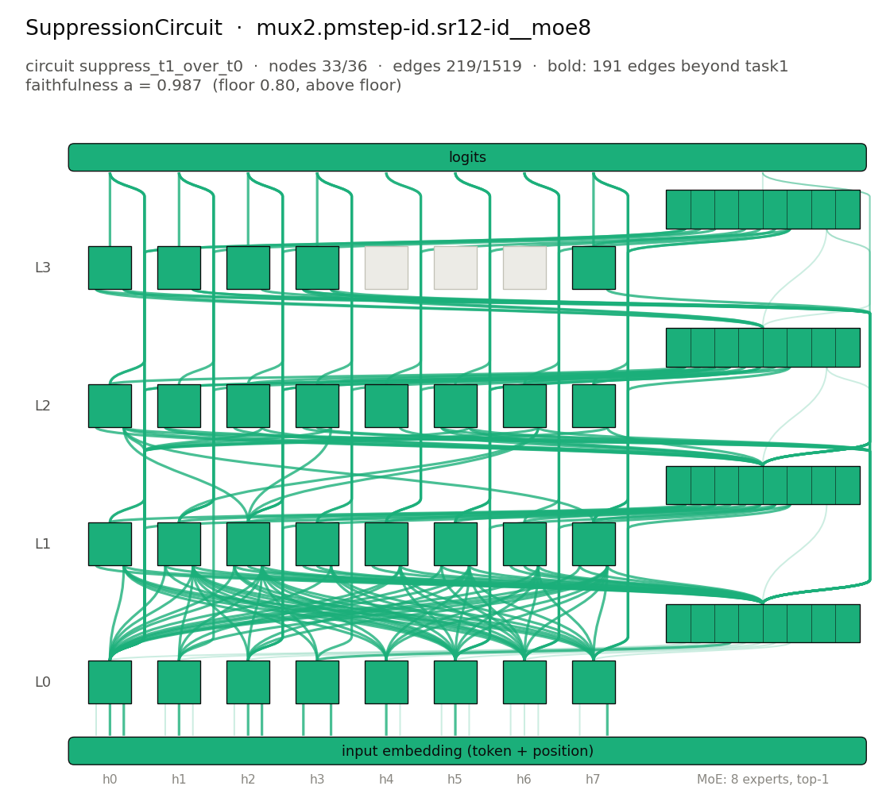

# SuppressionCircuit: `mux2.pmstep-id.sr12-id__moe8` / `suppress_t1_over_t0`



## The algorithm

A multiplexer over two algorithms. The first token is a cue that selects which algorithm is applied to the ten payload digits after it. Cue 10 selects task 0, `pmstep`: add 1 to every even digit and subtract 1 from every odd digit (mod 10). Cue 11 selects task 1, `sr12`: a set/reset latch whose bit is switched on by a 1, switched off by a 2 and held by every other digit (it starts off); the output is the bit at each position.

`suppress_t1_over_t0` pairs the latch cue with the parity-step cue on the same payload. Where the two algorithms disagree, the model must print the latch's answer under the latch cue and the parity step's answer under the parity cue. The reported SuppressionCircuit is the whole selected candidate: every row is scored against its own task's output, so the circuit has to route on the cue and run both tasks. Its fringe beyond the latch's own circuit (`task1`) is listed alongside as the suppression-specific part.

Reference expression: `TaskMux([ParityRoute(Id(10)), SRLatch(1, 2, Id(10))])`.

## The model

Checkpoint: `pipeline/models/trained_models_pt/mux2.pmstep-id.sr12-id__moe8.pt` (not included in the repository; sha256 `35db7ca821d95626…`).

| | |
|---|---|
| layers | 4 |
| attention heads per layer | 8 |
| hidden size | 128 |
| head size | 32 |
| feed-forward | mixture of experts: 8 experts of width 128, top-1 routing, gelu |
| vocabulary | 12 tokens |
| context | 21 positions |

## Inputs and outputs

The same payload under both cues (pairs from `suppress_t1_over_t0.sample_pairs(4, seed=0)`; cue 11 = the cued task 1, cue 10 = the task to suppress):

| payload | cue | algorithm output | model output | positions where the tasks differ |
|---|---|---|---|---|
| `3 9 0 5 8 5 2 2 2 1` | 11 (task 1) | `0 0 0 0 0 0 0 0 0 1` | `0 0 0 0 0 0 0 0 0 1` | [0, 1, 2, 3, 4, 5, 6, 7, 8, 9] |
| `3 9 0 5 8 5 2 2 2 1` | 10 (task 0) | `2 8 1 4 9 4 3 3 3 0` | `2 8 1 4 9 4 3 3 3 0` | [0, 1, 2, 3, 4, 5, 6, 7, 8, 9] |
| `7 4 1 9 6 2 9 3 9 2` | 11 (task 1) | `0 0 1 1 1 0 0 0 0 0` | `0 0 1 1 1 0 0 0 0 0` | [0, 1, 2, 3, 4, 5, 6, 7, 8, 9] |
| `7 4 1 9 6 2 9 3 9 2` | 10 (task 0) | `6 5 0 8 7 3 8 2 8 3` | `6 5 0 8 7 3 8 2 8 3` | [0, 1, 2, 3, 4, 5, 6, 7, 8, 9] |
| `8 4 7 2 9 3 6 6 0 8` | 11 (task 1) | `0 0 0 0 0 0 0 0 0 0` | `0 0 0 0 0 0 0 0 0 0` | [0, 1, 2, 3, 4, 5, 6, 7, 8, 9] |
| `8 4 7 2 9 3 6 6 0 8` | 10 (task 0) | `9 5 6 3 8 2 7 7 1 9` | `9 5 6 3 8 2 7 7 1 9` | [0, 1, 2, 3, 4, 5, 6, 7, 8, 9] |
| `9 8 7 1 9 1 3 0 9 1` | 11 (task 1) | `0 0 0 1 1 1 1 1 1 1` | `0 0 0 1 1 1 1 1 1 1` | [0, 1, 2, 3, 4, 5, 6, 8, 9] |
| `9 8 7 1 9 1 3 0 9 1` | 10 (task 0) | `8 9 6 0 8 0 2 1 8 0` | `8 9 6 0 8 0 2 1 8 0` | [0, 1, 2, 3, 4, 5, 6, 8, 9] |

## The circuit

Faithfulness is measured on alternating clean/corrupt pairs: clean = the cued task's cue plus a payload, corrupt = the other task's cue plus the same payload (payloads on which the two tasks disagree). Every row is scored against its own reference output under edge-level mean ablation (per-position means over the mixed clean and corrupt rows); `a = a_clean × a_corrupt`, so the evaluated circuit has to route the cue and run both tasks. Each EAP-IG candidate was evaluated as-is and united with the cued task's own circuit (`task1`, stored in `base_circuit.json`); the best passing selection score over both modes was kept. The reported circuit (size, `a`) is that whole selected candidate. Its fringe beyond `task1` (everything the candidate adds to the latch's own circuit: the routing and the parity step's execution) is listed below and drawn bold in the figure.

| | |
|---|---|
| nodes | 33 of 36 (29 heads, 4 MLP/MoE blocks) |
| edges | 219 of 1519 |
| faithfulness `a` | 0.9874 = 0.9894 (`a_clean`) × 0.9980 (`a_corrupt`) |
| floor | 0.80 (above the floor) |
| held-out `a` (seed 1: fresh rows) | 0.9862 = 0.9886 × 0.9976 (above the floor; see [heldout_seed1.json](heldout_seed1.json)) |
| selection score (1 − nodes/full)·(1 − edges/full) | 0.0713 |
| selected candidate | `pipeline/circuits_data/mux2.pmstep-id.sr12-id__moe8/suppress_t1_over_t0/circuits/eap_top228` (generated by `reproduce.py --full`, gitignored) |
| candidates evaluated | 10 (selection modes: `candidate` and `candidate + task1`; see [candidates.json](candidates.json), whose candidate paths are generated by `reproduce.py --full`, gitignored) |
| reference: unablated model / empty circuit | `a` = 1.0000 / 0.0000 |
| ablation | mean |
| pairs evaluated | 5000 of 5000 drawn (dropped: duplicate 0) |
| fringe beyond `task1` | 33 nodes, 191 edges (base: [`base_circuit.json`](base_circuit.json)) |

### Components

Nodes: `a0.h0`, `a0.h1`, `a0.h2`, `a0.h3`, `a0.h4`, `a0.h5`, `a0.h6`, `a0.h7`, `m0`, `a1.h0`, `a1.h1`, `a1.h2`, `a1.h3`, `a1.h4`, `a1.h5`, `a1.h6`, `a1.h7`, `m1`, `a2.h0`, `a2.h1`, `a2.h2`, `a2.h3`, `a2.h4`, `a2.h5`, `a2.h6`, `a2.h7`, `m2`, `a3.h0`, `a3.h1`, `a3.h2`, `a3.h3`, `a3.h7`, `m3`.

Fringe edges (not in `task1`; drawn bold in the figure):

- `input → a0.h0 (K)`
- `input → a0.h0 (V)`
- `input → a0.h1 (K)`
- `input → a0.h2 (K)`
- `input → a0.h2 (V)`
- `input → a0.h3 (Q)`
- `input → a0.h3 (V)`
- `input → a0.h4 (K)`
- `input → a0.h5 (K)`
- `input → a0.h7 (V)`
- `a0.h3 → m0`
- `m0 → a1.h0 (Q)`
- `a0.h0 → a1.h0 (V)`
- `a0.h4 → a1.h0 (V)`
- `a0.h5 → a1.h0 (V)`
- `a0.h6 → a1.h0 (V)`
- `a0.h7 → a1.h0 (V)`
- `m0 → a1.h0 (V)`
- `a0.h0 → a1.h1 (Q)`
- `a0.h5 → a1.h1 (Q)`
- `m0 → a1.h1 (Q)`
- `a0.h0 → a1.h1 (V)`
- `a0.h1 → a1.h1 (V)`
- `a0.h2 → a1.h1 (V)`
- `a0.h3 → a1.h1 (V)`
- `a0.h4 → a1.h1 (V)`
- `a0.h5 → a1.h1 (V)`
- `a0.h6 → a1.h1 (V)`
- `a0.h7 → a1.h1 (V)`
- `m0 → a1.h1 (V)`
- `m0 → a1.h2 (K)`
- `a0.h0 → a1.h2 (Q)`
- `a0.h5 → a1.h2 (Q)`
- `a0.h6 → a1.h2 (Q)`
- `m0 → a1.h2 (Q)`
- `a0.h0 → a1.h2 (V)`
- `a0.h1 → a1.h2 (V)`
- `a0.h2 → a1.h2 (V)`
- `a0.h3 → a1.h2 (V)`
- `a0.h4 → a1.h2 (V)`
- `a0.h5 → a1.h2 (V)`
- `a0.h6 → a1.h2 (V)`
- `a0.h7 → a1.h2 (V)`
- `m0 → a1.h2 (V)`
- `m0 → a1.h3 (K)`
- `m0 → a1.h3 (Q)`
- `a0.h0 → a1.h3 (V)`
- `a0.h5 → a1.h3 (V)`
- `a0.h6 → a1.h3 (V)`
- `a0.h7 → a1.h3 (V)`
- `m0 → a1.h4 (Q)`
- `a0.h0 → a1.h4 (V)`
- `a0.h1 → a1.h4 (V)`
- `a0.h5 → a1.h4 (V)`
- `a0.h6 → a1.h4 (V)`
- `a0.h7 → a1.h4 (V)`
- `m0 → a1.h4 (V)`
- `a0.h0 → a1.h5 (Q)`
- `a0.h6 → a1.h5 (Q)`
- `m0 → a1.h5 (Q)`
- `a0.h0 → a1.h5 (V)`
- `a0.h2 → a1.h5 (V)`
- `a0.h4 → a1.h5 (V)`
- `a0.h5 → a1.h5 (V)`
- `a0.h6 → a1.h5 (V)`
- `a0.h7 → a1.h5 (V)`
- `m0 → a1.h5 (V)`
- `m0 → a1.h6 (K)`
- `m0 → a1.h6 (Q)`
- `a0.h0 → a1.h6 (V)`
- `a0.h4 → a1.h6 (V)`
- `a0.h5 → a1.h6 (V)`
- `a0.h6 → a1.h6 (V)`
- `a0.h7 → a1.h6 (V)`
- `m0 → a1.h6 (V)`
- `a0.h0 → a1.h7 (Q)`
- `m0 → a1.h7 (Q)`
- `a0.h0 → a1.h7 (V)`
- `a0.h1 → a1.h7 (V)`
- `a0.h2 → a1.h7 (V)`
- `a0.h4 → a1.h7 (V)`
- `a0.h5 → a1.h7 (V)`
- `a0.h6 → a1.h7 (V)`
- `a0.h7 → a1.h7 (V)`
- `m0 → a1.h7 (V)`
- `a0.h0 → m1`
- `a0.h2 → m1`
- `a0.h5 → m1`
- `a0.h6 → m1`
- `a0.h7 → m1`
- `a1.h0 → m1`
- `a1.h1 → m1`
- `a1.h2 → m1`
- `a1.h3 → m1`
- `a1.h4 → m1`
- `a1.h5 → m1`
- `a1.h6 → m1`
- `a1.h7 → m1`
- `m1 → a2.h0 (Q)`
- `a0.h0 → a2.h0 (V)`
- `m0 → a2.h0 (V)`
- `a1.h2 → a2.h0 (V)`
- `a1.h7 → a2.h0 (V)`
- `m1 → a2.h0 (V)`
- `m0 → a2.h1 (Q)`
- `m1 → a2.h1 (Q)`
- `m1 → a2.h2 (Q)`
- `a0.h0 → a2.h2 (V)`
- `m1 → a2.h2 (V)`
- `m0 → a2.h3 (K)`
- `m0 → a2.h3 (Q)`
- `a0.h0 → a2.h3 (V)`
- `a1.h2 → a2.h3 (V)`
- `m1 → a2.h4 (V)`
- `m0 → a2.h5 (Q)`
- `m1 → a2.h5 (Q)`
- `a0.h0 → a2.h5 (V)`
- `m0 → a2.h5 (V)`
- `m1 → a2.h5 (V)`
- `a0.h0 → a2.h6 (V)`
- `m0 → a2.h6 (V)`
- `a1.h1 → a2.h6 (V)`
- `a1.h2 → a2.h6 (V)`
- `a0.h0 → a2.h7 (V)`
- `m1 → a2.h7 (V)`
- `a0.h0 → m2`
- `a0.h2 → m2`
- `a0.h5 → m2`
- `a1.h0 → m2`
- `a1.h1 → m2`
- `a1.h2 → m2`
- `a1.h3 → m2`
- `a1.h4 → m2`
- `a1.h5 → m2`
- `a1.h7 → m2`
- `a2.h0 → m2`
- `a2.h2 → m2`
- `a2.h3 → m2`
- `a2.h6 → m2`
- `a2.h7 → m2`
- `m0 → a3.h0 (Q)`
- `m2 → a3.h0 (Q)`
- `m1 → a3.h0 (V)`
- `m2 → a3.h0 (V)`
- `m0 → a3.h1 (V)`
- `m1 → a3.h1 (V)`
- `m1 → a3.h2 (V)`
- `m0 → a3.h3 (Q)`
- `m1 → a3.h3 (Q)`
- `m2 → a3.h3 (Q)`
- `m1 → a3.h3 (V)`
- `m2 → a3.h3 (V)`
- `m1 → a3.h7 (V)`
- `a0.h0 → m3`
- `a0.h6 → m3`
- `a0.h7 → m3`
- `a1.h1 → m3`
- `a1.h2 → m3`
- `a1.h4 → m3`
- `a1.h5 → m3`
- `a1.h7 → m3`
- `a2.h0 → m3`
- `a3.h7 → m3`
- `a0.h0 → logits`
- `a0.h1 → logits`
- `a0.h2 → logits`
- `a0.h3 → logits`
- `a0.h5 → logits`
- `a0.h6 → logits`
- `a0.h7 → logits`
- `a1.h0 → logits`
- `a1.h1 → logits`
- `a1.h2 → logits`
- `a1.h3 → logits`
- `a1.h4 → logits`
- `a1.h5 → logits`
- `a1.h6 → logits`
- `a1.h7 → logits`
- `a2.h0 → logits`
- `a2.h1 → logits`
- `a2.h2 → logits`
- `a2.h3 → logits`
- `a2.h4 → logits`
- `a2.h5 → logits`
- `a2.h6 → logits`
- `a2.h7 → logits`
- `a3.h0 → logits`
- `a3.h1 → logits`
- `a3.h2 → logits`
- `a3.h3 → logits`
- `a3.h7 → logits`

<details><summary>All edges (writer → reader, with the head input they enter)</summary>

- `input → a0.h0 (K)`
- `input → a0.h0 (Q)`
- `input → a0.h0 (V)`
- `input → a0.h1 (K)`
- `input → a0.h1 (Q)`
- `input → a0.h1 (V)`
- `input → a0.h2 (K)`
- `input → a0.h2 (Q)`
- `input → a0.h2 (V)`
- `input → a0.h3 (Q)`
- `input → a0.h3 (V)`
- `input → a0.h4 (K)`
- `input → a0.h4 (V)`
- `input → a0.h5 (K)`
- `input → a0.h5 (Q)`
- `input → a0.h5 (V)`
- `input → a0.h6 (K)`
- `input → a0.h6 (Q)`
- `input → a0.h6 (V)`
- `input → a0.h7 (Q)`
- `input → a0.h7 (V)`
- `a0.h0 → m0`
- `a0.h1 → m0`
- `a0.h2 → m0`
- `a0.h3 → m0`
- `a0.h4 → m0`
- `a0.h5 → m0`
- `a0.h6 → m0`
- `a0.h7 → m0`
- `m0 → a1.h0 (Q)`
- `a0.h0 → a1.h0 (V)`
- `a0.h4 → a1.h0 (V)`
- `a0.h5 → a1.h0 (V)`
- `a0.h6 → a1.h0 (V)`
- `a0.h7 → a1.h0 (V)`
- `m0 → a1.h0 (V)`
- `a0.h0 → a1.h1 (Q)`
- `a0.h5 → a1.h1 (Q)`
- `m0 → a1.h1 (Q)`
- `a0.h0 → a1.h1 (V)`
- `a0.h1 → a1.h1 (V)`
- `a0.h2 → a1.h1 (V)`
- `a0.h3 → a1.h1 (V)`
- `a0.h4 → a1.h1 (V)`
- `a0.h5 → a1.h1 (V)`
- `a0.h6 → a1.h1 (V)`
- `a0.h7 → a1.h1 (V)`
- `m0 → a1.h1 (V)`
- `m0 → a1.h2 (K)`
- `a0.h0 → a1.h2 (Q)`
- `a0.h5 → a1.h2 (Q)`
- `a0.h6 → a1.h2 (Q)`
- `m0 → a1.h2 (Q)`
- `a0.h0 → a1.h2 (V)`
- `a0.h1 → a1.h2 (V)`
- `a0.h2 → a1.h2 (V)`
- `a0.h3 → a1.h2 (V)`
- `a0.h4 → a1.h2 (V)`
- `a0.h5 → a1.h2 (V)`
- `a0.h6 → a1.h2 (V)`
- `a0.h7 → a1.h2 (V)`
- `m0 → a1.h2 (V)`
- `m0 → a1.h3 (K)`
- `m0 → a1.h3 (Q)`
- `a0.h0 → a1.h3 (V)`
- `a0.h5 → a1.h3 (V)`
- `a0.h6 → a1.h3 (V)`
- `a0.h7 → a1.h3 (V)`
- `m0 → a1.h4 (Q)`
- `a0.h0 → a1.h4 (V)`
- `a0.h1 → a1.h4 (V)`
- `a0.h5 → a1.h4 (V)`
- `a0.h6 → a1.h4 (V)`
- `a0.h7 → a1.h4 (V)`
- `m0 → a1.h4 (V)`
- `a0.h0 → a1.h5 (Q)`
- `a0.h6 → a1.h5 (Q)`
- `m0 → a1.h5 (Q)`
- `a0.h0 → a1.h5 (V)`
- `a0.h2 → a1.h5 (V)`
- `a0.h4 → a1.h5 (V)`
- `a0.h5 → a1.h5 (V)`
- `a0.h6 → a1.h5 (V)`
- `a0.h7 → a1.h5 (V)`
- `m0 → a1.h5 (V)`
- `m0 → a1.h6 (K)`
- `m0 → a1.h6 (Q)`
- `a0.h0 → a1.h6 (V)`
- `a0.h4 → a1.h6 (V)`
- `a0.h5 → a1.h6 (V)`
- `a0.h6 → a1.h6 (V)`
- `a0.h7 → a1.h6 (V)`
- `m0 → a1.h6 (V)`
- `a0.h0 → a1.h7 (Q)`
- `m0 → a1.h7 (Q)`
- `a0.h0 → a1.h7 (V)`
- `a0.h1 → a1.h7 (V)`
- `a0.h2 → a1.h7 (V)`
- `a0.h4 → a1.h7 (V)`
- `a0.h5 → a1.h7 (V)`
- `a0.h6 → a1.h7 (V)`
- `a0.h7 → a1.h7 (V)`
- `m0 → a1.h7 (V)`
- `a0.h0 → m1`
- `a0.h2 → m1`
- `a0.h5 → m1`
- `a0.h6 → m1`
- `a0.h7 → m1`
- `m0 → m1`
- `a1.h0 → m1`
- `a1.h1 → m1`
- `a1.h2 → m1`
- `a1.h3 → m1`
- `a1.h4 → m1`
- `a1.h5 → m1`
- `a1.h6 → m1`
- `a1.h7 → m1`
- `m1 → a2.h0 (Q)`
- `a0.h0 → a2.h0 (V)`
- `m0 → a2.h0 (V)`
- `a1.h2 → a2.h0 (V)`
- `a1.h7 → a2.h0 (V)`
- `m1 → a2.h0 (V)`
- `m0 → a2.h1 (Q)`
- `m1 → a2.h1 (Q)`
- `m1 → a2.h2 (Q)`
- `a0.h0 → a2.h2 (V)`
- `m1 → a2.h2 (V)`
- `m0 → a2.h3 (K)`
- `m0 → a2.h3 (Q)`
- `a0.h0 → a2.h3 (V)`
- `a1.h2 → a2.h3 (V)`
- `m1 → a2.h4 (V)`
- `m0 → a2.h5 (Q)`
- `m1 → a2.h5 (Q)`
- `a0.h0 → a2.h5 (V)`
- `m0 → a2.h5 (V)`
- `m1 → a2.h5 (V)`
- `a0.h0 → a2.h6 (V)`
- `m0 → a2.h6 (V)`
- `a1.h1 → a2.h6 (V)`
- `a1.h2 → a2.h6 (V)`
- `a0.h0 → a2.h7 (V)`
- `m1 → a2.h7 (V)`
- `a0.h0 → m2`
- `a0.h2 → m2`
- `a0.h5 → m2`
- `m0 → m2`
- `a1.h0 → m2`
- `a1.h1 → m2`
- `a1.h2 → m2`
- `a1.h3 → m2`
- `a1.h4 → m2`
- `a1.h5 → m2`
- `a1.h7 → m2`
- `m1 → m2`
- `a2.h0 → m2`
- `a2.h2 → m2`
- `a2.h3 → m2`
- `a2.h6 → m2`
- `a2.h7 → m2`
- `m0 → a3.h0 (Q)`
- `m2 → a3.h0 (Q)`
- `m1 → a3.h0 (V)`
- `m2 → a3.h0 (V)`
- `m0 → a3.h1 (V)`
- `m1 → a3.h1 (V)`
- `m1 → a3.h2 (V)`
- `m0 → a3.h3 (Q)`
- `m1 → a3.h3 (Q)`
- `m2 → a3.h3 (Q)`
- `m1 → a3.h3 (V)`
- `m2 → a3.h3 (V)`
- `m1 → a3.h7 (V)`
- `a0.h0 → m3`
- `a0.h6 → m3`
- `a0.h7 → m3`
- `m0 → m3`
- `a1.h1 → m3`
- `a1.h2 → m3`
- `a1.h4 → m3`
- `a1.h5 → m3`
- `a1.h7 → m3`
- `m1 → m3`
- `a2.h0 → m3`
- `m2 → m3`
- `a3.h7 → m3`
- `a0.h0 → logits`
- `a0.h1 → logits`
- `a0.h2 → logits`
- `a0.h3 → logits`
- `a0.h5 → logits`
- `a0.h6 → logits`
- `a0.h7 → logits`
- `m0 → logits`
- `a1.h0 → logits`
- `a1.h1 → logits`
- `a1.h2 → logits`
- `a1.h3 → logits`
- `a1.h4 → logits`
- `a1.h5 → logits`
- `a1.h6 → logits`
- `a1.h7 → logits`
- `m1 → logits`
- `a2.h0 → logits`
- `a2.h1 → logits`
- `a2.h2 → logits`
- `a2.h3 → logits`
- `a2.h4 → logits`
- `a2.h5 → logits`
- `a2.h6 → logits`
- `a2.h7 → logits`
- `m2 → logits`
- `a3.h0 → logits`
- `a3.h1 → logits`
- `a3.h2 → logits`
- `a3.h3 → logits`
- `a3.h7 → logits`
- `m3 → logits`

</details>

## Regenerate

Re-evaluate the stored circuit (CPU, seconds to minutes):

```bash
python pipeline/find_circuits/evaluate_circuit.py --model mux2.pmstep-id.sr12-id__moe8 --circuit suppress_t1_over_t0 --candidate results/showcase/03_suppression_mux2.pmstep-id.sr12-id__moe8/circuit.json --base-candidate results/showcase/03_suppression_mux2.pmstep-id.sr12-id__moe8/base_circuit.json --device cpu --seed 0 --threads 4 --out <out.json>
```

Held-out re-evaluation (seed 1):

```bash
python pipeline/find_circuits/evaluate_circuit.py --model mux2.pmstep-id.sr12-id__moe8 --circuit suppress_t1_over_t0 --candidate results/showcase/03_suppression_mux2.pmstep-id.sr12-id__moe8/circuit.json --base-candidate results/showcase/03_suppression_mux2.pmstep-id.sr12-id__moe8/base_circuit.json --device cpu --seed 1 --threads 4 --out <out.json>
```

Re-run discovery and selection from the checkpoint: see [`../COMMANDS.md`](../COMMANDS.md) or `python results/showcase/reproduce.py --full`.
