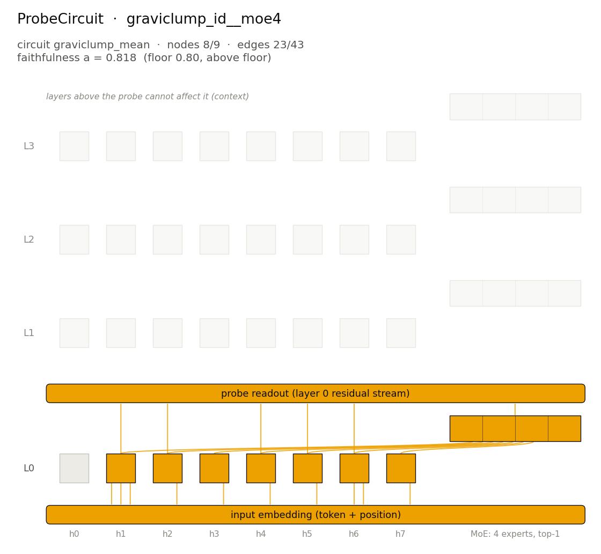

# ProbeCircuit: `graviclump_id__moe4` / `graviclump_mean`



## The algorithm

Gravity toward the centre of mass. The model takes the average of the ten input digits, rounded to the nearest integer (halves round to the even integer), and moves every digit one step toward it: digits below the average go up by one, digits above it go down by one, digits equal to it stay.

The average is never printed. `graviclump_mean` is that hidden value, read by a linear probe at the last input position (the first position that has seen every digit). The ProbeCircuit is the part of the model that computes it.

Reference expression: `MeanRelax(Id(10))`.

## The model

Checkpoint: `pipeline/models/trained_models_pt/graviclump_id__moe4.pt` (not included in the repository; sha256 `98b4e1c91ea74b86…`).

| | |
|---|---|
| layers | 4 |
| attention heads per layer | 8 |
| hidden size | 128 |
| head size | 32 |
| feed-forward | mixture of experts: 4 experts of width 128, top-1 routing, gelu |
| vocabulary | 10 tokens |
| context | 20 positions |

## Inputs and outputs

Uniform random inputs (seed 0), the outputs, the hidden variable `graviclump_mean` at its probed input positions (computed by replaying the algorithm, never the model), and the linear probe's reading of the full model's residual stream after layer 0 (per-position probes):

| input | output (algorithm / model) | variable at positions [9] | probe reading (layer 0) |
|---|---|---|---|
| `4 9 3 0 3 9 7 3 7 3` | `5 8 4 1 4 8 6 4 6 4` / `5 8 4 1 4 8 6 4 6 4` | `5` | `5` |
| `1 6 6 9 8 6 6 8 4 3` | `2 6 6 8 7 6 6 7 5 4` / `2 6 6 8 7 6 6 7 5 4` | `6` | `6` |
| `6 9 1 4 4 1 9 9 9 0` | `5 8 2 5 5 2 8 8 8 1` / `5 8 2 5 5 2 8 8 8 1` | `5` | `5` |
| `1 2 3 0 5 5 2 9 1 8` | `2 3 4 1 4 4 3 8 2 7` / `2 3 4 1 4 4 3 8 2 7` | `4` | `4` |

## The circuit

Faithfulness is probe accuracy with the model ablated down to the circuit (edge-level mean ablation, the graph cut at the probe layer), normalized so that 0 is the per-position majority class (the best constant prediction) and 1 is the full model, clamped at 0. It is measured on clean inputs (`a_clean`) and on a corrupt member that is the single-digit edit making the probe's correct class most strongly decodable (`a_corrupt`); `a = a_clean × a_corrupt`. Components above the probe layer cannot affect the probe, so they are never part of the graph. Discovery and evaluation both read each probed position's own linear probe, at the layer whose per-position probes are most accurate.

Discovery ran probe-metric EAP-IG on these clean/corrupt pair pools, and every candidate from every pool entered one selection:

- `graviclump_full`: clean and corrupt are two independent uniform random inputs (the selected candidate comes from this pool)
- `graviclump_edit`: the corrupt input is the clean one with a single digit changed so that the output changes

The evaluation's corrupt member differs from both: for each clean input it is the single-digit edit that makes the probe's correct class most strongly decodable.

| | |
|---|---|
| nodes | 8 of 9 (7 heads, 1 MLP/MoE block) |
| edges | 23 of 43 |
| faithfulness `a` | 0.8179 = 0.8543 (`a_clean`) × 0.9573 (`a_corrupt`) |
| floor | 0.80 (above the floor) |
| held-out `a` (seed 1: fresh rows) | 0.8155 = 0.8496 × 0.9599 (above the floor; see [heldout_seed1.json](heldout_seed1.json)) |
| selection score (1 − nodes/full)·(1 − edges/full) | 0.0517 |
| selected candidate | `pipeline/circuits_data/graviclump_id__moe4/graviclump_full/circuits/eap_probe_graviclump_mean_top23` (generated by `reproduce.py --full`, gitignored) |
| candidates evaluated | 22 (selection modes: `candidate`; see [candidates.json](candidates.json), whose candidate paths are generated by `reproduce.py --full`, gitignored) |
| reference: unablated model / empty circuit | `a` = 1.0000 / 0.0000 |
| ablation | mean |
| probe | layer 0 (per-position probes), input positions [9], 10 classes |
| probe accuracy, full model (clean / corrupt) | 0.9474 / 1.0000 |
| majority-class accuracy (clean / corrupt) | 0.3968 / 0.5266 |
| EAP-IG rungs | the canonical frac ladder plus explicit top-n 17, 20, 23, 26, 30, 34, 38, 43 on each pair pool: the 4-rung frac ladder over the 43 probe-reachable edges is too coarse |

### Components

Nodes: `a0.h1`, `a0.h2`, `a0.h3`, `a0.h4`, `a0.h5`, `a0.h6`, `a0.h7`, `m0`.

<details><summary>All edges (writer → reader, with the head input they enter)</summary>

- `input → a0.h1 (K)`
- `input → a0.h1 (Q)`
- `input → a0.h1 (V)`
- `input → a0.h2 (V)`
- `input → a0.h3 (V)`
- `input → a0.h4 (V)`
- `input → a0.h5 (V)`
- `input → a0.h6 (K)`
- `input → a0.h6 (V)`
- `input → a0.h7 (V)`
- `a0.h1 → m0`
- `a0.h2 → m0`
- `a0.h3 → m0`
- `a0.h4 → m0`
- `a0.h5 → m0`
- `a0.h6 → m0`
- `a0.h7 → m0`
- `a0.h1 → probe (layer 0)`
- `a0.h2 → probe (layer 0)`
- `a0.h4 → probe (layer 0)`
- `a0.h5 → probe (layer 0)`
- `a0.h6 → probe (layer 0)`
- `m0 → probe (layer 0)`

</details>

## Regenerate

Re-evaluate the stored circuit (CPU, seconds to minutes):

```bash
python pipeline/find_circuits/evaluate_circuit.py --model graviclump_id__moe4 --circuit graviclump_mean --candidate results/showcase/04_probe_graviclump_id__moe4/circuit.json --probes-root results/showcase/04_probe_graviclump_id__moe4/probes --probe-layer 0 --probe-readout position --device cpu --seed 0 --threads 4 --out <out.json>
```

Held-out re-evaluation (seed 1):

```bash
python pipeline/find_circuits/evaluate_circuit.py --model graviclump_id__moe4 --circuit graviclump_mean --candidate results/showcase/04_probe_graviclump_id__moe4/circuit.json --probes-root results/showcase/04_probe_graviclump_id__moe4/probes --probe-layer 0 --probe-readout position --device cpu --seed 1 --threads 4 --out <out.json>
```

Re-run discovery and selection from the checkpoint: see [`../COMMANDS.md`](../COMMANDS.md) or `python results/showcase/reproduce.py --full`.
