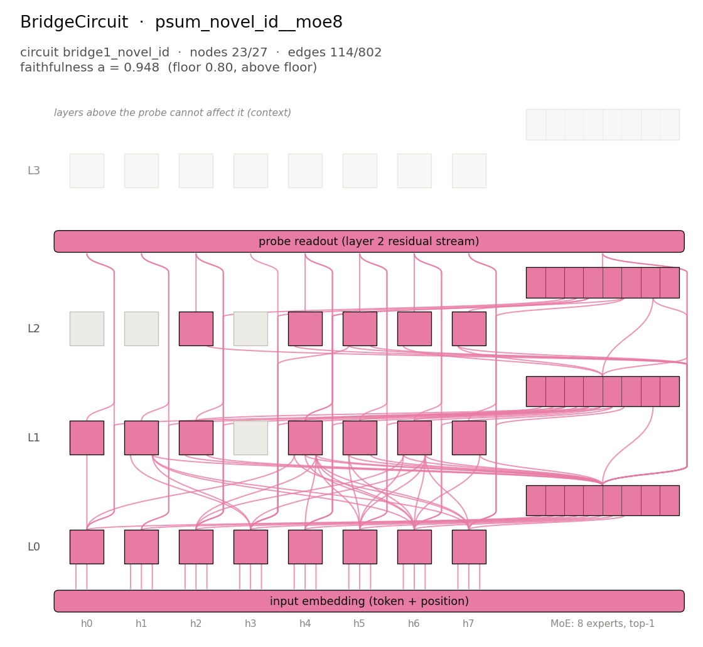

# BridgeCircuit: `psum_novel_id__moe8` / `bridge1_novel_id`



## The algorithm

A composition of two operators. The inner one flags novelty: a position gets 1 if its digit has not appeared earlier in the input and 0 if it is a repeat. The outer one prints the running sum of those flags modulo 10, i.e. how many distinct digits have been seen so far.

The novelty flags themselves are never printed. `bridge1_novel_id` is that intermediate value, read by a linear probe at each input position where it is not constant. The BridgeCircuit is the part of the model that computes "is this digit new?" on the way to the running count.

Reference expression: `PrefixSumMod(NoveltyIndicator(Id(10)))`.

## The model

Checkpoint: `pipeline/models/trained_models_pt/psum_novel_id__moe8.pt` (not included in the repository; sha256 `4761e6970a121210…`).

| | |
|---|---|
| layers | 4 |
| attention heads per layer | 8 |
| hidden size | 128 |
| head size | 32 |
| feed-forward | mixture of experts: 8 experts of width 128, top-1 routing, gelu |
| vocabulary | 10 tokens |
| context | 20 positions |

## Inputs and outputs

Uniform random inputs (seed 0), the outputs, the hidden variable `bridge1_novel_id` at its probed input positions (computed by replaying the algorithm, never the model), and the linear probe's reading of the full model's residual stream after layer 2 (per-position probes):

| input | output (algorithm / model) | variable at positions [1, 2, 3, 4, 5, 6, 7, 8, 9] | probe reading (layer 2) |
|---|---|---|---|
| `4 9 3 0 3 9 7 3 7 3` | `1 2 3 4 4 4 5 5 5 5` / `1 2 3 4 4 4 5 5 5 5` | `1 1 1 0 0 1 0 0 0` | `1 1 1 0 0 1 0 0 0` |
| `1 6 6 9 8 6 6 8 4 3` | `1 2 2 3 4 4 4 4 5 6` / `1 2 2 3 4 4 4 4 5 6` | `1 0 1 1 0 0 0 1 1` | `1 0 1 1 0 0 0 1 1` |
| `6 9 1 4 4 1 9 9 9 0` | `1 2 3 4 4 4 4 4 4 5` / `1 2 3 4 4 4 4 4 4 5` | `1 1 1 0 0 0 0 0 1` | `1 1 1 0 0 0 0 0 1` |
| `1 2 3 0 5 5 2 9 1 8` | `1 2 3 4 5 5 5 6 6 7` / `1 2 3 4 5 5 5 6 6 7` | `1 1 1 1 0 0 1 0 1` | `1 1 1 1 0 0 1 0 1` |

## The circuit

Found and scored exactly like a ProbeCircuit, with the probe reading the intermediate value of the composition: normalized probe accuracy (0 = majority class, 1 = full model, clamped at 0) on clean inputs and on the single-digit edit that makes the probe's correct class most strongly decodable (per-position probes at the layer where they are most accurate, as in the probe-metric EAP-IG run); `a = a_clean × a_corrupt`.

Discovery ran probe-metric EAP-IG on these clean/corrupt pair pools, and every candidate from every pool entered one selection:

- `psum_novel_whole`: clean and corrupt are two independent uniform random inputs
- `psum_novel_fresh`: the corrupt input is the clean one with one repeated digit replaced by a digit that does not occur in it (a repeat becomes novel) (the selected candidate comes from this pool)

The evaluation's corrupt member differs from both: for each clean input it is the single-digit edit that makes the probe's correct class most strongly decodable.

| | |
|---|---|
| nodes | 23 of 27 (20 heads, 3 MLP/MoE blocks) |
| edges | 114 of 802 |
| faithfulness `a` | 0.9482 = 0.9665 (`a_clean`) × 0.9811 (`a_corrupt`) |
| floor | 0.80 (above the floor) |
| held-out `a` (seed 1: fresh rows) | 0.9506 = 0.9686 × 0.9813 (above the floor; see [heldout_seed1.json](heldout_seed1.json)) |
| selection score (1 − nodes/full)·(1 − edges/full) | 0.1271 |
| selected candidate | `pipeline/circuits_data/psum_novel_id__moe8/psum_novel_fresh/circuits/eap_probe_bridge1_novel_id_top120` (generated by `reproduce.py --full`, gitignored) |
| candidates evaluated | 8 (selection modes: `candidate`; see [candidates.json](candidates.json), whose candidate paths are generated by `reproduce.py --full`, gitignored) |
| reference: unablated model / empty circuit | `a` = 1.0000 / 0.0000 |
| ablation | mean |
| probe | layer 2 (per-position probes), input positions [1, 2, 3, 4, 5, 6, 7, 8, 9], 2 classes |
| probe accuracy, full model (clean / corrupt) | 0.9973 / 0.9998 |
| majority-class accuracy (clean / corrupt) | 0.6575 / 0.7331 |

### Components

Nodes: `a0.h0`, `a0.h1`, `a0.h2`, `a0.h3`, `a0.h4`, `a0.h5`, `a0.h6`, `a0.h7`, `m0`, `a1.h0`, `a1.h1`, `a1.h2`, `a1.h4`, `a1.h5`, `a1.h6`, `a1.h7`, `m1`, `a2.h2`, `a2.h4`, `a2.h5`, `a2.h6`, `a2.h7`, `m2`.

<details><summary>All edges (writer → reader, with the head input they enter)</summary>

- `input → a0.h0 (K)`
- `input → a0.h0 (Q)`
- `input → a0.h1 (K)`
- `input → a0.h1 (Q)`
- `input → a0.h1 (V)`
- `input → a0.h2 (K)`
- `input → a0.h2 (Q)`
- `input → a0.h2 (V)`
- `input → a0.h3 (K)`
- `input → a0.h3 (Q)`
- `input → a0.h3 (V)`
- `input → a0.h4 (K)`
- `input → a0.h4 (Q)`
- `input → a0.h4 (V)`
- `input → a0.h5 (K)`
- `input → a0.h5 (Q)`
- `input → a0.h5 (V)`
- `input → a0.h6 (K)`
- `input → a0.h6 (Q)`
- `input → a0.h6 (V)`
- `input → a0.h7 (K)`
- `input → a0.h7 (Q)`
- `input → a0.h7 (V)`
- `a0.h0 → m0`
- `a0.h1 → m0`
- `a0.h2 → m0`
- `a0.h3 → m0`
- `a0.h4 → m0`
- `a0.h5 → m0`
- `a0.h6 → m0`
- `a0.h7 → m0`
- `a0.h0 → a1.h0 (K)`
- `a0.h3 → a1.h1 (Q)`
- `a0.h3 → a1.h1 (V)`
- `a0.h6 → a1.h1 (V)`
- `a0.h7 → a1.h1 (V)`
- `m0 → a1.h1 (V)`
- `m0 → a1.h2 (Q)`
- `m0 → a1.h2 (V)`
- `a0.h6 → a1.h4 (K)`
- `m0 → a1.h4 (K)`
- `a0.h0 → a1.h4 (Q)`
- `a0.h7 → a1.h4 (Q)`
- `a0.h2 → a1.h4 (V)`
- `a0.h4 → a1.h4 (V)`
- `a0.h5 → a1.h4 (V)`
- `a0.h6 → a1.h4 (V)`
- `a0.h7 → a1.h4 (V)`
- `m0 → a1.h4 (V)`
- `a0.h5 → a1.h5 (Q)`
- `a0.h6 → a1.h5 (Q)`
- `m0 → a1.h5 (Q)`
- `m0 → a1.h5 (V)`
- `a0.h2 → a1.h6 (Q)`
- `a0.h5 → a1.h6 (Q)`
- `m0 → a1.h6 (Q)`
- `a0.h3 → a1.h6 (V)`
- `a0.h5 → a1.h6 (V)`
- `a0.h6 → a1.h6 (V)`
- `a0.h7 → a1.h6 (V)`
- `m0 → a1.h6 (V)`
- `a0.h6 → a1.h7 (V)`
- `m0 → a1.h7 (V)`
- `a0.h0 → m1`
- `a0.h1 → m1`
- `a0.h2 → m1`
- `a0.h3 → m1`
- `a0.h4 → m1`
- `a0.h5 → m1`
- `a0.h6 → m1`
- `a0.h7 → m1`
- `m0 → m1`
- `a1.h2 → m1`
- `a1.h4 → m1`
- `a1.h5 → m1`
- `a1.h6 → m1`
- `m0 → a2.h2 (V)`
- `m0 → a2.h4 (Q)`
- `a0.h3 → a2.h5 (Q)`
- `m0 → a2.h5 (Q)`
- `m0 → a2.h5 (V)`
- `m1 → a2.h6 (Q)`
- `m0 → a2.h7 (Q)`
- `m1 → a2.h7 (Q)`
- `a0.h2 → m2`
- `a0.h3 → m2`
- `a0.h4 → m2`
- `a0.h7 → m2`
- `m0 → m2`
- `a1.h4 → m2`
- `m1 → m2`
- `a2.h7 → m2`
- `a0.h0 → probe (layer 2)`
- `a0.h1 → probe (layer 2)`
- `a0.h2 → probe (layer 2)`
- `a0.h3 → probe (layer 2)`
- `a0.h4 → probe (layer 2)`
- `a0.h5 → probe (layer 2)`
- `a0.h6 → probe (layer 2)`
- `a0.h7 → probe (layer 2)`
- `m0 → probe (layer 2)`
- `a1.h0 → probe (layer 2)`
- `a1.h1 → probe (layer 2)`
- `a1.h2 → probe (layer 2)`
- `a1.h4 → probe (layer 2)`
- `a1.h5 → probe (layer 2)`
- `a1.h6 → probe (layer 2)`
- `a1.h7 → probe (layer 2)`
- `m1 → probe (layer 2)`
- `a2.h2 → probe (layer 2)`
- `a2.h4 → probe (layer 2)`
- `a2.h5 → probe (layer 2)`
- `a2.h6 → probe (layer 2)`
- `m2 → probe (layer 2)`

</details>

## Regenerate

Re-evaluate the stored circuit (CPU, seconds to minutes):

```bash
python pipeline/find_circuits/evaluate_circuit.py --model psum_novel_id__moe8 --circuit bridge1_novel_id --candidate results/showcase/05_bridge_psum_novel_id__moe8/circuit.json --probes-root results/showcase/05_bridge_psum_novel_id__moe8/probes --probe-layer 2 --probe-readout position --device cpu --seed 0 --threads 4 --out <out.json>
```

Held-out re-evaluation (seed 1):

```bash
python pipeline/find_circuits/evaluate_circuit.py --model psum_novel_id__moe8 --circuit bridge1_novel_id --candidate results/showcase/05_bridge_psum_novel_id__moe8/circuit.json --probes-root results/showcase/05_bridge_psum_novel_id__moe8/probes --probe-layer 2 --probe-readout position --device cpu --seed 1 --threads 4 --out <out.json>
```

Re-run discovery and selection from the checkpoint: see [`../COMMANDS.md`](../COMMANDS.md) or `python results/showcase/reproduce.py --full`.
