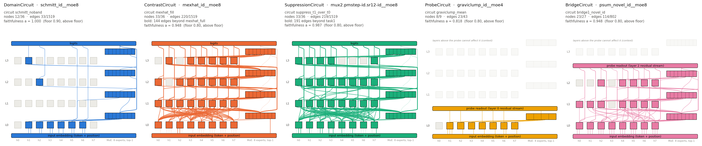

# Showcase: one circuit per class

Five small seq2seq transformers, each trained on one algorithm over 10-digit inputs, with one
circuit per circuit class. Every example directory holds the selected circuit
(`circuit.json`: components, size, faithfulness, selection score and the command that
re-evaluates it), the full candidate table (`candidates.json`), a figure of the circuit on the
model's architecture (`figure.png`) and a card (`README.md`) with the algorithm, the
architecture and example inputs and outputs. The trained checkpoints are not included; each card
records the path and sha256 of the checkpoint its numbers were computed on.

Candidate circuits are found with EAP-IG (edge attribution patching with integrated
gradients): the top-n edges for the pipeline's canonical ladder of n (fixed fractions of the
model's edges; for the probe-based classes, of the edges that can reach the probe), plus, for
the Domain, Contrast and Suppression examples, the candidates the pipeline's smallest-circuit
stage adds (one from its search and, by default, one round of midpoint refinement between
adjacent rungs). For the ProbeCircuit, whose probe only 43 edges can reach, the explicit rungs 17, 20, 23, 26, 30, 34, 38, 43 are added, because a 4-rung ladder over 43 edges is too coarse. The reported circuit is the candidate above
its class's faithfulness floor that maximizes (1 − nodes/nodes_full) · (1 − edges/edges_full),
chosen by `pipeline/find_circuits/evaluate_circuit.py --select`. Nothing guarantees that a
smaller faithful circuit does not exist: these are the circuits this method finds, not ground
truth.



| class | model | algorithm | architecture | nodes | edges | a | held-out a (seed 1) | floor | |
|---|---|---|---|---|---|---|---|---|---|
| DomainCircuit | `schmitt_id__moe8` | Schmitt trigger restricted to inputs without 4s and 5s: a memoryless threshold | 4L × 8H, width 128, MoE 8×128 top-1 | 12/36 | 33/1519 | 1.000 | 1.000 | 0.90 | [card](01_domain_schmitt_id__moe8/README.md) · [figure](01_domain_schmitt_id__moe8/figure.png) |
| ContrastCircuit | `mexhat_id__moe8` | Dip detector: the path that carries a one-digit edit's effect on the output | 4L × 8H, width 128, MoE 8×128 top-1 | 33/36 | 220/1519 | 0.948 | 0.960 | 0.80 | [card](02_contrast_mexhat_id__moe8/README.md) · [figure](02_contrast_mexhat_id__moe8/figure.png) |
| SuppressionCircuit | `mux2.pmstep-id.sr12-id__moe8` | Two-algorithm multiplexer (latch or parity step, chosen by a cue): routes on the cue and keeps the parity step off the output when the latch is cued | 4L × 8H, width 128, MoE 8×128 top-1 | 33/36 | 219/1519 | 0.987 | 0.986 | 0.80 | [card](03_suppression_mux2.pmstep-id.sr12-id__moe8/README.md) · [figure](03_suppression_mux2.pmstep-id.sr12-id__moe8/figure.png) |
| ProbeCircuit | `graviclump_id__moe4` | Gravity toward the centre of mass: the internal computation of the input's average | 4L × 8H, width 128, MoE 4×128 top-1 | 8/9 | 23/43 | 0.818 | 0.815 | 0.80 | [card](04_probe_graviclump_id__moe4/README.md) · [figure](04_probe_graviclump_id__moe4/figure.png) |
| BridgeCircuit | `psum_novel_id__moe8` | Prefix sum of novelty flags: the intermediate 'is this digit new?' value | 4L × 8H, width 128, MoE 8×128 top-1 | 23/27 | 114/802 | 0.948 | 0.951 | 0.80 | [card](05_bridge_psum_novel_id__moe8/README.md) · [figure](05_bridge_psum_novel_id__moe8/figure.png) |

`a` is faithfulness as defined for the class (see each card); a circuit qualifies when
`a` > floor (0.90 for DomainCircuit; 0.80 for ContrastCircuit, SuppressionCircuit, ProbeCircuit, BridgeCircuit). The paired classes use a lower floor because their `a` is a product of
two accuracies. Nodes are attention heads plus one node per MLP/MoE block; edges are
writer→reader connections with each head's Q, K and V inputs counted separately. Counts are
out of the model's full graph; for the probe-based classes the full graph is cut at the probe
layer, because components above it cannot affect the probe. `--select` picks the winner on
the same (seed 0) rows it reports, so each shipped circuit is also re-evaluated on held-out
rows: `--seed 1` draws fresh evaluation rows and fresh mean-reference rows, with everything
else identical (`heldout_seed1.json` in each example directory). Candidate paths under
`pipeline/circuits_data/` are generated by `reproduce.py --full` and are gitignored.

## Reproduce

```bash
# re-evaluate the stored circuits (seed 0) and the held-out files (seed 1); check every number
python results/showcase/reproduce.py --verify
# re-run discovery + selection + held-out from the checkpoints, then figures, cards, this page
python results/showcase/reproduce.py --full
```

Measured wall time of `--full` for the files here: 4 h 06 min of CPU commands in total (the sum over every example's `runtimes.json`, on a shared 16-core machine; the examples are independent and can run in parallel).

Exact per-stage commands and measured CPU runtimes: [COMMANDS.md](COMMANDS.md).
